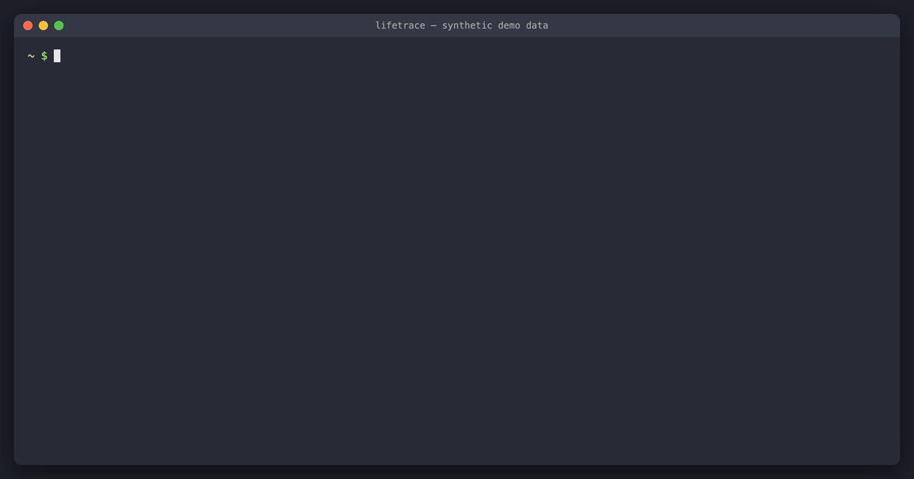

**English** | [简体中文](README.zh-CN.md)

# lifetrace

[](https://github.com/risingjerry/lifetrace/actions/workflows/ci.yml)
[](LICENSE)


**lifetrace** is a local macOS activity recorder built for you and your AI agents.

A small event-driven Swift daemon listens to macOS system notifications—without a polling loop—and writes an append-only JSONL log (`act.v1`) plus a local SQLite/FTS5 index under `~/.local/share/lifetrace`. It records which app, window, document, and web page is in front and for how long, active vs. idle vs. away time, per-minute input counts (counts only, never key identities), and redacted visible window text via the macOS Accessibility API. Optional stdlib-only Python readers bring in browser history, Claude Code and Codex transcripts, zsh history, git commits, media projects, and Apple Calendar.

**It never records the screen, screenshots, audio, or which keys you press, and it makes zero network calls.**



---

## Quick Start (First Result in 2 Minutes)

Requires **macOS 13+**, **Xcode Command Line Tools** (`xcode-select --install`, Swift 5.10+), and **Python 3.9+** (the system `python3` works for optional source readers). There is no Homebrew formula or prebuilt binary; you build from source so you control what runs on your Mac:

```sh
git clone https://github.com/risingjerry/lifetrace && cd lifetrace
make install          # builds, code-signs, installs ~/.local/bin/lifetrace, writes LaunchAgent (not loaded)
```

Make sure `~/.local/bin` is on your `PATH`, then grant **Accessibility** permission so lifetrace can read window titles, documents, URLs, and input counts:

1. Open **System Settings → Privacy & Security → Accessibility**.
2. Click **+**, press **Cmd+Shift+G**, type `~/.local/bin/lifetrace`, and turn the toggle on.

Start the background LaunchAgent and check your first output:

```sh
launchctl bootstrap gui/$(id -u) ~/Library/LaunchAgents/dev.lifetrace.recorder.plist
lifetrace status
lifetrace timeline today
lifetrace stats --day today
```

---

## What Questions Can It Answer?

- **Where did my time go today?** — Active vs. idle time per app, website domain, and window (`lifetrace stats`).
- **What was I doing at 3:00 PM yesterday?** — Exact frontmost segment, state (`active`, `idle`, `away`), surrounding focus changes, and nearby source events (`lifetrace at "2026-10-28 15:00"`).
- **How many interruptions did I have this week, and what was my longest focus block?** — App switches, A → B → A interruptions (≤ 2 min), 25+ minute deep focus blocks, and hourly active breakdown (`lifetrace stats --week`).
- **When did I see "invoice" on screen or in a prompt?** — Full-text trigram + substring search across visible window text snapshots, text selections, window titles, URLs, and external sources (`lifetrace search invoice`).

---

## Use with Claude Code, Codex, and Other Agents

Every CLI command supports `--json` and returns a single JSON object with `"v": "act.v1"`. Agents can query lifetrace via the bundled **Agent Skill**, the **MCP server**, or direct CLI calls.

### 1. Install the Agent Skill

Install the [`skills/lifetrace`](skills/lifetrace/SKILL.md) skill so your coding agent knows the query order, field semantics (`active_s` vs. `dur_s`), and privacy rules:

```sh
npx skills add risingjerry/lifetrace
```

### 2. Or Connect the MCP Server

`lifetrace_mcp` is a thin stdio wrapper around `lifetrace ... --json` (requires Python 3.10+ and `pip install mcp`):

```sh
# Claude Code
claude mcp add lifetrace -- python3 /path/to/lifetrace/lifetrace_mcp/__main__.py

# Codex
codex mcp add lifetrace -- python3 /path/to/lifetrace/lifetrace_mcp/__main__.py
```

It exposes seven tools: `lifetrace_status`, `lifetrace_schema`, `lifetrace_timeline`, `lifetrace_at`, `lifetrace_stats`, `lifetrace_events`, and `lifetrace_search`.

### 3. Ask Your Agent

Try prompts like:
- *"Where did my time go today? Separate active work from idle time, and tell me my longest focus block and most fragmented hours."*
- *"What was I working on yesterday around 3pm, including any git commits, shell commands, or Claude Code prompts?"*
- *"When did I last look at the error message or invoice number `INV-2048` on screen, and what file or web page was open?"*

---

## CLI Commands

Every command accepts `--json` for structured `act.v1` output (errors return `{"v":"act.v1","error":"..."}` with exit code 2).

| Command | Description |
|---|---|
| `lifetrace status [--json]` | Recorder health, PID, memory/CPU footprint, granted permissions, and today's event count. |
| `lifetrace timeline [DATE] [--raw] [--sources] [--json]` | Ordered focus blocks and away gaps for a day (`today`, `yesterday`, or `YYYY-MM-DD`). Fills missing browser URLs from history (`url_src: "history"`) and attaches active messenger `chats` (`[{chat, in, out}]`) when source records exist. `--raw` shows unmerged segments; `--sources` interleaves external sources. |
| `lifetrace at TIME [--json]` | What was happening at one moment (`"14:30"`, `"2026-10-28 14:30"`, or ISO 8601), plus raw events and sources within ±2 min. |
| `lifetrace stats [--day DATE \| --week [DATE]] [--top N] [--json]` | Totals, time by app/domain/window, active time by hour, app switches, interruptions, and longest focus block. |
| `lifetrace search QUERY [--from T] [--to T] [--source NAME\|act] [--limit N] [--json]` | Full-text search across on-screen text snapshots, selections, window titles, URLs, and external source records. |
| `lifetrace events [--seg ID] [--from T] [--to T] [--type PREFIX] [--source NAME] [--limit N]` | Raw `act.v1` events by segment ID, time window, event type prefix, or external source name. |
| `lifetrace tail [--json]` | Follow newly recorded events live as they are appended to today's log. |
| `lifetrace pause [--minutes N] \| resume` | Pause recording (optionally auto-resuming after `N` minutes) or resume immediately. |
| `lifetrace schema [--json]` | Print the full `act.v1` schema documentation or JSON spec. |
| `lifetrace reindex` | Rebuild `index.sqlite` from the raw JSONL event and source logs. |
| `lifetrace daemon` | Run the recorder in the foreground (used by the LaunchAgent). |

---

## How It Works

```
macOS Events (NSWorkspace, Accessibility, CGEventTap, Lock/Sleep/Idle)
   │
   ▼
lifetrace daemon (Swift, event-driven)
   │  appends
   ▼
~/.local/share/lifetrace/events/YYYY-MM-DD.jsonl   ◄── Source of truth (act.v1)
   │                                               
   ├──► ~/.local/share/lifetrace/index.sqlite      ◄── Derived SQLite + FTS5 trigram index
   │                                               
~/.local/share/lifetrace/sources/<name>/YYYY-MM-DD.jsonl
   ▲
   │  appends (every 15 min)
lifetrace_sources (stdlib Python readers: browser, claude, codex, shell, git, media_projects, calendar)
```

1. **Five Recording Layers in the Daemon ([SCHEMA.md](SCHEMA.md)):**
   - **Layer 1 — Presence (`presence.*`):** Screen lock/unlock, system sleep/wake, display sleep/wake, and idle detection (no keyboard/mouse/trackpad input for 60 s, back-dated to the exact last input timestamp). "Away" means locked, asleep, display off, or paused.
   - **Layer 2 — Focus (`focus.*`):** Frontmost app (`app`, `bundle`, `pid`) and, with Accessibility, focused window ID, window title, document path (`AXDocument`), and web page URL.
   - **Layer 3 — Segments (`segment.end`):** Continuous stretches in the same app + window + document/URL while present, recording `dur_s`, `active_s`, `idle_s`, `glance` (< 2 s pass-through), and end reason.
   - **Layer 4 — Input Intensity (`activity.minute` & segment totals):** Listen-only event tap counting `keys`, `clicks`, `scrolls`, `scroll_px`, `copies`, and `pastes` per active minute and per segment. Only counts are stored—never which keys were pressed.
   - **Layer 5 — On-Screen Content (`content.snapshot`, `content.selection`):** Reads visible text and selections from the focused window via the Accessibility API (never pixels or screenshots), bounded to 400 elements / 30 ms per read, deduplicated by FNV-1a hash, and redacted before write.
2. **Layer 6 — Optional External Source Readers ([SOURCES.md](SOURCES.md)):**
   - `lifetrace_sources` is a zero-dependency Python package that incrementally reads app-native stores into `sources/<source>/YYYY-MM-DD.jsonl`:
     - `browser`: Safari and Chromium-family browsers (Chrome, Arc, Brave, Edge, Dia) under `~/Library/Application Support`.
     - `claude` & `codex`: User prompts (≤ 2 KB, redacted) and cumulative session summaries (turns, tool call counts, model, working directory) from `~/.claude/projects` and `~/.codex/sessions`.
     - `shell`: Commands and durations from `~/.zsh_history`.
     - `git`: Commits authored by you across your configured git roots.
     - `media_projects`: Modified project metadata for CapCut / JianyingPro, After Effects, Blender, and Final Cut Pro.
     - `calendar`: Events from local Apple Calendar SQLite caches.
   - Readers never modify the apps they inspect; SQLite databases (plus WAL files) are copied to a private temporary directory before querying, and unchanged browser databases, git repositories, and folders are skipped.
   - Add your own custom readers outside the repository via `"extra_readers": ["~/path/to/reader.py"]` in `~/.config/lifetrace/config.json` (see [SOURCES.md](SOURCES.md#extra-readers-your-own-sources)). Messenger source records with `chat_name` are also summarized on matching `timeline` focus blocks as `chats: [{chat, in, out}]`.

### Enabling External Source Readers (Optional)

```sh
# Test with a dry run first (writes nothing)
python3 -m lifetrace_sources run --dry-run

# Write the LaunchAgent (runs every 15 minutes from this git checkout; keep the clone)
make install-sources
launchctl bootstrap gui/$(id -u) ~/Library/LaunchAgents/dev.lifetrace.sources.plist

# Check reader status
python3 -m lifetrace_sources status

# Re-apply current redaction rules to already stored source records (optional maintenance)
python3 -m lifetrace_sources rescrub --data-dir ~/.local/share/lifetrace [--dedupe-shell-estimated] [--dry-run]
```

### Resource Footprint

Measured on the maintainer's Apple-silicon Mac while recording (`lifetrace status`), the Swift daemon uses **about 5 MB of memory footprint** and **about 0.04% average CPU** (this is one machine's observation; your mileage may vary with window-switching frequency). Source readers skip unchanged browser databases, git repositories, and folders, so a steady-state 15-minute run takes **about 2 s** instead of 20–30 s on a real machine.

---

## Privacy, Redaction, and Permissions

- **100% Local:** All data lives in `~/.local/share/lifetrace` (`0700` directories, `0600` source files). No cloud sync, telemetry, or network requests.
- **No Pixels, Audio, or Key Identities:** lifetrace never calls screen capture APIs, never records audio, and never logs which keys you press.
- **Skipped by Default:**
  - Password fields (`AXSecureTextField`) and their children are never read.
  - Private / Incognito / InPrivate / 无痕 / 隐私浏览 browser windows skip layer-5 content capture (best effort via window title/toolbar).
  - Sensitive apps in `content_exclude_bundles` skip layer-5 content capture by default: password managers (1Password, Bitwarden, Keychain Access, Apple Passwords, KeePassXC, LastPass, Dashlane, Enpass), hardware/crypto wallets (OneKey, Ledger), and banking/payment apps (Alipay, PayPal, CMB, ICBC, CCB, BOC, ABC, BoCom).
- **Heuristic Redaction:** Before any title, URL, path, on-screen text, shell command, or prompt is written to disk, lifetrace masks secrets and personal data as `[REDACTED…]`—including PEM private keys, JWTs, `sk-…`, GitHub PATs (`ghp_…`, `github_pat_…`), AWS access keys, Google `AIza…`, Slack `xox…`, Bearer tokens, `password=`/`api_key=`/`密码：`/`口令：`/`令牌：` assignments, long hex/base64-like tokens, mainland mobile numbers and e-mail addresses anywhere in text, and URL query/fragment parameters for credentials (`token`, `key`, `secret`, `password`, `code`, `session`, `auth`, `sig`, etc.) as well as personal data (`phone`/`mobile`/`tel`, `email`, coordinates such as `lat`/`lng`/`lon`, account IDs such as `uid`/`openid`/`unionid`/`user_id`, and ID-card numbers `idcard`/`id_card`). Ordinary URL paths and long numeric IDs are kept. To re-apply updated redaction rules to already stored source records (and optionally deduplicate estimated shell history bursts), run `python3 -m lifetrace_sources rescrub --data-dir DIR [--dedupe-shell-estimated] [--dry-run]`.
- **Permissions and Code Signing:**
  - **Accessibility (`~/.local/bin/lifetrace`):** Required for window titles, document paths, URLs, on-screen text, and input counts. Without it, lifetrace still runs at `"level": "app"` (recording only app names and presence).
  - **Full Disk Access (`python3`, optional):** Only needed if you use `lifetrace_sources` and want Safari history or Apple Calendar events. Without it, those two readers report `unavailable` and all other readers still run.
  - **Automation (optional, off by default):** Only requested if you set `"browser_applescript": true` in config so Chromium browsers expose the active tab URL on live events (even with it off, `timeline`, `stats`, and `at` fill URLs from browser history once `lifetrace_sources` has run).
  - **Code Signing across Rebuilds:** macOS ties the Accessibility grant to the binary's code-signing requirement (`dev.lifetrace.recorder`). `make` automatically signs with the first `"Apple Development"` certificate in your keychain (or `SIGN_IDENTITY="..."`). If you have no Apple Development certificate, it falls back to ad-hoc signing (`-`), which works but requires re-toggling Accessibility permission after each rebuild.

---

## Configuration and Time Zones

Configuration is optional and lives at `~/.config/lifetrace/config.json` (override with `$LIFETRACE_CONFIG`; data dir override is `$LIFETRACE_HOME`). See [`docs/config.example.json`](docs/config.example.json):

```json
{
  "utc_offset": "+08:00",
  "idle_threshold_s": 60,
  "content": true,
  "input_counts": true,
  "browser_applescript": false,
  "git_roots": ["~/Projects", "~/work"],
  "git_authors": ["you@example.com"],
  "extra_readers": []
}
```

**Fixed UTC Offset:** Days and timestamps use a single fixed UTC offset—`$LIFETRACE_UTC_OFFSET`, or `"utc_offset"` in `config.json`, or your Mac's UTC offset when the process starts. There is no daylight-saving switching inside a run, keeping day boundaries (`YYYY-MM-DD.jsonl`) unambiguous.

**Custom Window Titles (`title_commands`):** For apps whose window title says nothing useful (e.g. GPU-drawn terminal workspaces), set `"title_commands": {"bundle.id": ["/abs/path/to/helper"]}` in `config.json`. The helper program prints the real title on line 1 and an optional absolute document/folder path on line 2 (run on focus changes and throttled after input, with a 0.5 s timeout and redaction applied). Full config details are in [SCHEMA.md](SCHEMA.md) and [SOURCES.md](SOURCES.md).

---

## How Does lifetrace Compare to Alternatives?

| Tool | Approach | Where lifetrace Differs |
|---|---|---|
| **ActivityWatch** | Open-source, cross-platform, watcher plugins with a local web dashboard. | lifetrace is macOS-only and agent-first (single binary + JSON/MCP/Skill instead of a web UI), adding per-segment input intensity (`keys`/`clicks`/`scrolls`) and searchable on-screen Accessibility text. |
| **Apple Screen Time** | Built into macOS; tracks app and website totals. | Screen Time does not expose per-window/document history, on-screen text search, or a documented local query interface for AI agents. |
| **RescueTime / Timing** | Polished commercial apps with automatic categorization and dashboards. | Paid services/apps; lifetrace is MIT-licensed, stores plain append-only JSONL + SQLite locally, and is designed to be queried directly by your own agents. |

---

## Limitations

- **macOS 13+ only.** Built directly on `NSWorkspace`, `ApplicationServices` (Accessibility), and `CGEventTap`.
- **Chromium browsers and on-screen text:** Chrome, Arc, Edge, Brave, and Dia only expose their toolbar to the macOS Accessibility API by default unless full Chromium accessibility is forced on (which lifetrace intentionally does not enable because it costs browser CPU and memory). For Chromium browsers, searchable text comes from window titles and the `browser` history reader, not page bodies. Live tab URLs on raw focus/segment events require opting into `"browser_applescript": true`, but `timeline`, `stats` (`by_domain`), and `at` fill the page URL from browser history automatically (`url_src: "history"`) once the source readers have run. Safari exposes both URLs and page text natively.
- **Without Accessibility permission**, only frontmost application names and bundle IDs are recorded (`status.level` is `"app"`).
- **Redaction is heuristic, not a mathematical guarantee.** While common API keys, tokens, and password fields are excluded or masked, treat `~/.local/share/lifetrace` as sensitive personal data.
- **Built from source, not notarized.** You compile and sign it locally with Xcode Command Line Tools.

---

## FAQ

### How to track time spent per app on Mac locally?
Install lifetrace (`make install`), grant Accessibility permission, and run `lifetrace stats --day today` or `lifetrace timeline today`. It logs every app, window, document, and URL switch into `~/.local/share/lifetrace/events/YYYY-MM-DD.jsonl` and computes active time (with keyboard/mouse input) separately from idle time (no input for 60+ seconds).

### Is lifetrace safe? Does it record keystrokes or screenshots?
No screenshots, screen recordings, audio, or key identities are ever captured. Input counting (`activity.minute`) uses a listen-only event tap that increments integer counters (`keys`, `clicks`, `scrolls`, `copies`, `pastes`) and immediately discards the event—it never records which key was pressed. On-screen text is read through the macOS Accessibility tree (skipping `AXSecureTextField` password fields, password managers, wallets, banking apps, and private browsing windows) and passed through secret redaction before touching disk.

### Does it work with Google Chrome, Arc, Brave, or Safari?
Yes. Safari works out of the box for window titles, URLs, and on-screen page text. For Chromium-based browsers (Chrome, Arc, Brave, Edge, Dia), window titles are captured automatically, and once the `browser` source reader (`lifetrace_sources`) has run, `timeline`, `stats` (`by_domain`), and `at` automatically fill missing page URLs from browser history (marked `url_src: "history"`). If you also want real-time active tab URLs on live events before the source reader runs, set `"browser_applescript": true` in `~/.config/lifetrace/config.json`.

### How to let Claude Code or Codex see what I worked on today?
Install the skill with `npx skills add risingjerry/lifetrace` or register the MCP server (`claude mcp add lifetrace -- python3 /path/to/lifetrace/lifetrace_mcp/__main__.py`). Then ask your agent *"What did I work on today?"* or *"Summarize my week from lifetrace."* The agent will call `lifetrace stats`, `lifetrace timeline`, and `lifetrace search` locally.

---

## Uninstall

```sh
make uninstall
```

This stops and unloads both LaunchAgents (`dev.lifetrace.recorder` and `dev.lifetrace.sources`) and removes `~/.local/bin/lifetrace`, `~/.local/share/lifetrace/SCHEMA.md`, and the `.plist` files in `~/Library/LaunchAgents`. Your recorded activity data in `~/.local/share/lifetrace` is kept until you delete it yourself (`rm -rf ~/.local/share/lifetrace`).

---

## Documentation, Contributing, and Security

- **Data Schema (`act.v1`):** [SCHEMA.md](SCHEMA.md)
- **External Source Readers & Custom Plug-ins:** [SOURCES.md](SOURCES.md)
- **Agent Skill Instructions:** [skills/lifetrace/SKILL.md](skills/lifetrace/SKILL.md)
- **Repository & Developer Guide:** [AGENTS.md](AGENTS.md)
- **Contributing:** See [CONTRIBUTING.md](CONTRIBUTING.md). Run `make test` to run both the Swift XCTest suite and Python synthetic unit tests.
- **Security Policy:** See [SECURITY.md](SECURITY.md) for reporting redaction or privacy bugs privately.
- **License:** [MIT](LICENSE) © risingjerry.

---

## Star History

If lifetrace helps you or your AI agents understand how you spend time on your Mac, please consider giving the repo a ⭐ on GitHub!

[](https://star-history.com/#risingjerry/lifetrace&Date)
