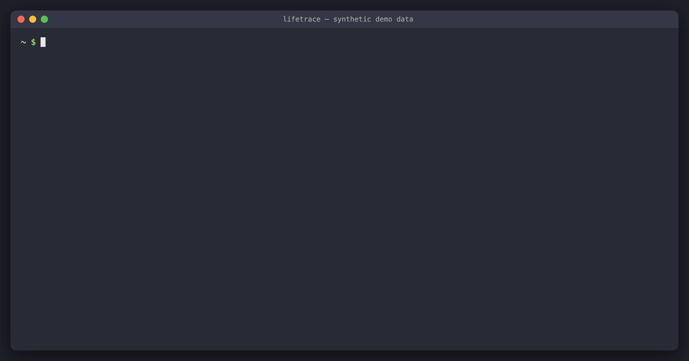

[English](README.md) | **简体中文**

# lifetrace

[](https://github.com/risingjerry/lifetrace/actions/workflows/ci.yml)
[](LICENSE)


**lifetrace** 是专为 Mac 用户和 AI Agent 打造的本地活动记录工具。

它由一个事件驱动的轻量级 Swift 守护进程（无轮询循环）和本地 SQLite/FTS5 全文索引组成，所有数据以只追加（append-only）的 JSONL 日志（`act.v1`）形式保存在 `~/.local/share/lifetrace`。它会记录当前前台的应用、窗口、文档路径与网页 URL 及其停留时长，区分活跃（有输入）、空闲（60 秒无操作）与离开（锁屏、休眠、息屏、暂停），按分钟统计键鼠输入强度（仅统计按键、点击、滚动、复制、粘贴的次数，绝不记录具体按了哪个键），并通过 macOS 辅助功能（Accessibility API）抓取当前焦点窗口的可见文本（自动脱敏，且跳过密码框、密码管理器、钱包、银行应用及无痕浏览窗口）。此外，可选的纯 Python 标准库读取器（`lifetrace_sources`）还支持增量导入浏览器历史、Claude Code 与 Codex 会话记录、zsh 命令历史、Git 提交、创作工程（剪映专业版/CapCut、After Effects、Blender、Final Cut Pro）以及 Apple 日历。

**它绝不录屏、不截图、不录音、不记录具体按键内容，且不发起任何网络请求。**



---

## 快速上手（2 分钟看到第一份结果）

系统要求：**macOS 13+**、**Xcode Command Line Tools**（`xcode-select --install`，需 Swift 5.10+）以及 **Python 3.9+**（系统自带的 `python3` 即可运行可选的数据源读取器）。本项目不提供 Homebrew 或预编译二进制包，直接从源码编译，确保你对运行在自己 Mac 上的代码完全可控：

```sh
git clone https://github.com/risingjerry/lifetrace && cd lifetrace
make install          # 编译、代码签名、安装 ~/.local/bin/lifetrace 并生成 LaunchAgent（默认不自动加载）
```

请确保 `~/.local/bin` 已加入 `PATH`，然后为 `lifetrace` 授予**辅助功能（Accessibility）**权限，以便读取窗口标题、文档路径、网页 URL 和统计输入次数：

1. 打开 **系统设置 → 隐私与安全性 → 辅助功能**。
2. 点击 **+**，按 **Cmd+Shift+G**，输入 `~/.local/bin/lifetrace` 添加并打开开关。

启动后台服务并查看你的第一条记录：

```sh
launchctl bootstrap gui/$(id -u) ~/Library/LaunchAgents/dev.lifetrace.recorder.plist
lifetrace status
lifetrace timeline today
lifetrace stats --day today
```

---

## 它能回答哪些问题？

- **我今天的时间都花在哪了？** — 按应用、网站域名和具体窗口统计活跃时间与空闲时间（`lifetrace stats`）。
- **昨天下午 3 点我在干嘛？** — 精确还原当时的前台时间段、状态（`active`、`idle`、`away`）、前后的焦点切换以及正负 2 分钟内的外部数据源事件（`lifetrace at "2026-10-28 15:00"`）。
- **这周我被打断了多少次？最长的一次连续专注有多久？** — 统计应用切换次数、A → B → A 短暂打断（≤ 2 分钟）、25 分钟以上的深度专注块以及每小时活跃分布（`lifetrace stats --week`）。
- **我什么时候在屏幕上或对话里见过“invoice”？** — 基于 FTS5 trigram 与子串匹配，全文检索屏幕可见文本快照、选中文本、窗口标题、URL 以及外部数据源（`lifetrace search invoice`）。

---

## 配合 Claude Code、Codex 等 AI Agent 使用

所有 CLI 命令均支持 `--json`，输出包含 `"v": "act.v1"` 的单一 JSON 对象。你可以直接安装内置的 **Agent Skill**，或者挂载 **MCP Server** 让 AI 助手直接查询你的本地活动记录。

### 1. 安装 Agent Skill

安装 [`skills/lifetrace`](skills/lifetrace/SKILL.md) 技能，让 Agent 自动掌握查询顺序、字段含义（如 `active_s` 活跃时间与 `dur_s` 停留时间的区别）以及隐私保护规则：

```sh
npx skills add risingjerry/lifetrace
```

### 2. 或配置 MCP Server

`lifetrace_mcp` 是基于 stdio 的轻量封装，底层直接调用 `lifetrace ... --json`（需要 Python 3.10+ 并安装 `pip install mcp`）：

```sh
# Claude Code
claude mcp add lifetrace -- python3 /path/to/lifetrace/lifetrace_mcp/__main__.py

# Codex
codex mcp add lifetrace -- python3 /path/to/lifetrace/lifetrace_mcp/__main__.py
```

提供 7 个工具：`lifetrace_status`、`lifetrace_schema`、`lifetrace_timeline`、`lifetrace_at`、`lifetrace_stats`、`lifetrace_events` 和 `lifetrace_search`。

### 3. 直接向 Agent 提问

你可以这样问 Claude Code 或 Codex：
- *“帮我看看今天时间都花在哪了？把实际活跃操作时间和发呆空闲时间分开算，顺便告诉我今天最长的一次专注和最碎片化的时间段。”*
- *“昨天下午三点左右我在忙什么？结合那段时间的 git 提交、终端命令和 Claude Code 提问记录帮我回顾一下。”*
- *“我上次在屏幕上看到 `INV-2048` 这个编号是什么时候？当时打开的是哪个文件或网页？”*

---

## 命令行一览（CLI）

每个命令都支持 `--json` 输出结构化 `act.v1` 数据（报错时返回 `{"v":"act.v1","error":"..."}`，退出码为 2）。

| 命令 | 说明 |
|---|---|
| `lifetrace status [--json]` | 查看守护进程运行状态、PID、内存与 CPU 占用、权限状态及今日事件数。 |
| `lifetrace timeline [DATE] [--raw] [--sources] [--json]` | 按时间顺序展示某一天的专注时间块与离开空隙（支持 `today`、`yesterday` 或 `YYYY-MM-DD`）。缺失实时 URL 的浏览器块会自动用历史记录补齐（标记 `url_src: "history"`），聊天应用的专注块还会附带会话列表 `chats`（`[{chat, in, out}]`）。`--raw` 展示未合并的原始片段；`--sources` 穿插展示外部数据源事件。 |
| `lifetrace at TIME [--json]` | 查询某一时刻正在发生什么（支持 `"14:30"`、`"2026-10-28 14:30"` 或 ISO 8601），并附带前后 2 分钟内的原始事件与外部源记录。 |
| `lifetrace stats [--day DATE \| --week [DATE]] [--top N] [--json]` | 汇总统计：按应用/域名/窗口统计时长、每小时活跃分布、应用切换次数、被打断次数及最长专注时间块。 |
| `lifetrace search QUERY [--from T] [--to T] [--source NAME\|act] [--limit N] [--json]` | 全文检索屏幕上见过的文本快照、选中文本、窗口标题、URL 以及外部数据源记录（支持中英文检索）。 |
| `lifetrace events [--seg ID] [--from T] [--to T] [--type PREFIX] [--source NAME] [--limit N]` | 按片段 ID（`seg`）、时间范围、事件类型前缀或外部数据源名称查询原始 `act.v1` 记录。 |
| `lifetrace tail [--json]` | 实时流式查看新写入今日日志的事件。 |
| `lifetrace pause [--minutes N] \| resume` | 暂停记录（可通过 `--minutes N` 指定自动恢复时间）或立即恢复记录。 |
| `lifetrace schema [--json]` | 打印完整的 `act.v1` 数据格式文档或 JSON Schema。 |
| `lifetrace reindex` | 根据原始 JSONL 事件与数据源日志重新构建 `index.sqlite` 索引。 |
| `lifetrace daemon` | 在前台运行记录守护进程（供 LaunchAgent 调用）。 |

---

## 工作原理

```
macOS 系统事件 (NSWorkspace, Accessibility, CGEventTap, 锁屏/休眠/空闲检测)
   │
   ▼
lifetrace daemon (Swift 事件驱动守护进程)
   │  只追加写入
   ▼
~/.local/share/lifetrace/events/YYYY-MM-DD.jsonl   ◄── 唯一事实来源 (act.v1)
   │                                               
   ├──► ~/.local/share/lifetrace/index.sqlite      ◄── 派生 SQLite + FTS5 trigram 全文索引
   │                                               
~/.local/share/lifetrace/sources/<name>/YYYY-MM-DD.jsonl
   ▲
   │  增量追加 (每 15 分钟)
lifetrace_sources (Python 标准库读取器: browser, claude, codex, shell, git, media_projects, calendar)
```

1. **守护进程的 5 层记录模型（详见 [SCHEMA.md](SCHEMA.md)）：**
   - **第 1 层 — 在场状态（`presence.*`）：** 锁屏/解锁、系统休眠/唤醒、显示器休眠/唤醒，以及空闲检测（连续 60 秒无键鼠/触控板输入即判定为空闲，且空闲起始时间会自动回溯到最后一次输入的精确时刻）。锁屏、休眠、息屏或暂停期间均记为离开（`away`）。
   - **第 2 层 — 焦点切换（`focus.*`）：** 前台应用（`app`、`bundle`、`pid`），并在授予辅助功能权限后记录焦点窗口 ID、窗口标题、文档路径（`AXDocument`）和网页 URL。
   - **第 3 层 — 时间片段（`segment.end`）：** 人在电脑前且处于同一应用 + 窗口 + 文档/URL 的连续时间段，记录总时长 `dur_s`、活跃时长 `active_s`、空闲时长 `idle_s`、是否只是小于 2 秒的切换掠过（`glance`）以及结束原因。
   - **第 4 层 — 输入强度（`activity.minute` 与片段汇总）：** 通过只读事件监听统计每分钟和每个片段内的按键数（`keys`）、点击数（`clicks`）、滚动次数（`scrolls`）、滚动像素（`scroll_px`）、复制次数（`copies`）和粘贴次数（`pastes`）。只存计数，绝不记录按下了哪个键。
   - **第 5 层 — 屏幕可见文本（`content.snapshot`, `content.selection`）：** 仅通过 macOS 辅助功能 API 读取焦点窗口的可见文字与选中文本（绝不读取像素或截图），单次读取严格限制在 400 个节点 / 30 毫秒以内，按 FNV-1a 哈希去重，并在落盘前完成敏感信息脱敏。
2. **第 6 层 — 可选的外部应用数据源（详见 [SOURCES.md](SOURCES.md)）：**
   - `lifetrace_sources` 是一个零第三方依赖的 Python 包，将本机应用的原生数据增量同步到 `sources/<source>/YYYY-MM-DD.jsonl`：
     - `browser`：Safari 以及 `~/Library/Application Support` 下的 Chromium 内核浏览器（Chrome、Arc、Brave、Edge、Dia）访问历史。
     - `claude` 与 `codex`：从 `~/.claude/projects` 和 `~/.codex/sessions` 提取用户 Prompt（≤ 2 KB，自动脱敏）与会话汇总（轮数、工具调用计数、模型、工作目录）。
     - `shell`：`~/.zsh_history` 中的终端命令与执行耗时。
     - `git`：指定代码目录下由你提交的 Git commit 记录与改动行数。
     - `media_projects`：剪映专业版（JianyingPro）/ CapCut、After Effects、Blender、Final Cut Pro 的工程修改元数据。
     - `calendar`：本地 Apple 日历 SQLite 缓存中的日程事件。
   - 读取器绝不修改原应用的数据；读取 SQLite 数据库时，会先将 DB 与 WAL 文件复制到私有临时目录后再查询，并自动跳过未发生变化的浏览器数据库、Git 仓库与目录。
   - 如需接入私人或工作专属的数据源，可在 `~/.config/lifetrace/config.json` 中通过 `"extra_readers": ["~/path/to/reader.py"]` 加载仓库外部的自定义脚本（详见 [SOURCES.md](SOURCES.md#extra-readers-your-own-sources)）。带有 `chat_name` 的聊天软件数据源记录还会在 `timeline` 对应的应用专注块中汇总为 `chats: [{chat, in, out}]`。

### 启用外部数据源读取器（可选）

```sh
# 先试运行一次（--dry-run 仅打印统计计数，不写入任何文件）
python3 -m lifetrace_sources run --dry-run

# 生成 LaunchAgent 配置（每 15 分钟直接从当前代码仓库目录运行，请保留 clone 目录）
make install-sources
launchctl bootstrap gui/$(id -u) ~/Library/LaunchAgents/dev.lifetrace.sources.plist

# 查看各数据源状态
python3 -m lifetrace_sources status

# 对已落盘的数据源记录重新应用最新脱敏规则（可选维护命令）
python3 -m lifetrace_sources rescrub --data-dir ~/.local/share/lifetrace [--dedupe-shell-estimated] [--dry-run]
```

若 `~/.local/bin/agent-run`（或 `AGENT_RUN` 指定的路径）可执行，数据源安装器会将它放在任务命令最前面。
这个可选的稳定启动器让 macOS 隐私权限绑定到它，而不随 Python 升级改变；请给启动器授予所需权限。
没有可执行的启动器时，命令保持原样。

### 资源占用

在维护者的 Apple Silicon Mac 上日常记录时实测（通过 `lifetrace status` 查看），Swift 守护进程的**内存占用（footprint）约为 5 MB**，**平均 CPU 占用约为 0.04%**（此为单机实测观察值，实际占用会随窗口切换频率略有浮动）。数据源读取器会自动跳过未变更的浏览器数据库、Git 仓库与文件夹，因此日常每 15 分钟一次的稳态增量运行在真机上仅需**约 2 秒**（而非 20–30 秒）。

---

## 隐私保护、脱敏与系统权限

- **100% 本地存储：** 所有数据保存在 `~/.local/share/lifetrace`（目录权限 `0700`，数据源文件权限 `0600`），无任何云同步、遥测或网络请求。
- **不碰像素、音频与具体按键：** 不调用屏幕录制 API、不录音、不记录具体按键内容。
- **默认跳过敏感场景：**
  - 密码输入框（`AXSecureTextField`）及其子元素绝不读取。
  - 浏览器无痕/隐私窗口（窗口标题或工具栏包含 Private Browsing / Incognito / InPrivate / 无痕 / 隐私浏览）自动跳过第 5 层正文抓取。
  - 默认排除列表（`content_exclude_bundles`）中的应用不会抓取第 5 层窗口文本：涵盖主流密码管理器（1Password、Bitwarden、钥匙串访问、Apple 密码、KeePassXC、LastPass、Dashlane、Enpass）、硬件/加密钱包（OneKey、Ledger）以及支付与银行应用（支付宝、PayPal、招商银行、工商银行、建设银行、中国银行、农业银行、交通银行）。
- **启发式自动脱敏：** 在窗口标题、URL、文件路径、屏幕文本、终端命令或 Prompt 写入磁盘前，lifetrace 不仅屏蔽密钥，还会屏蔽个人隐私数据，统一替换为 `[REDACTED…]`——包括 PEM 私钥块、JWT、`sk-…`、GitHub PAT（`ghp_…`、`github_pat_…`）、AWS Access Key、Google `AIza…`、Slack `xox…`、Bearer Token、`password=`/`api_key=`/`密码：`/`口令：`/`令牌：` 赋值语句、超长十六进制或 Base64 令牌、文本中任意位置的中国大陆手机号与电子邮箱地址，以及 URL 查询参数/Fragment 中的凭证参数（`token`、`key`、`secret`、`password`、`code`、`session`、`auth`、`sig` 等）和个人信息参数（手机号 `phone`/`mobile`/`tel`、邮箱 `email`、经纬度坐标 `lat`/`lng`/`lon` 等、账号 ID `uid`/`openid`/`unionid`/`user_id` 以及身份证号 `idcard`/`id_card`）；普通 URL 路径与纯数字长 ID 则予以保留。如需对已保存的历史数据源记录重新执行最新脱敏规则（或对无精确时间戳的 zsh 历史重复项去重），可运行 `python3 -m lifetrace_sources rescrub --data-dir DIR [--dedupe-shell-estimated] [--dry-run]`。
- **权限说明与代码签名：**
  - **辅助功能（`~/.local/bin/lifetrace`）：** 用于读取窗口标题、文档路径、URL、窗口文本和输入计数。若未授权，lifetrace 依然能以 `"level": "app"` 模式运行（仅记录前台应用名称与在场状态）。
  - **完全磁盘访问权限（`python3`，可选）：** 仅当你启用 `lifetrace_sources` 且需要读取 Safari 历史记录或 Apple 日历时才需为 `python3` 授权；未授权时这两个读取器会标记为 `unavailable`，不影响其他读取器正常工作。
  - **自动化权限（Automation，可选，默认关闭）：** 仅当你在配置中主动开启 `"browser_applescript": true` 以实时获取 Chromium 浏览器当前标签页 URL 时，macOS 才会弹窗询问（即便关闭，只要运行过 `lifetrace_sources`，查询命令也会自动从浏览器历史补齐 URL）。
  - **重编译与代码签名：** macOS 将辅助功能权限绑定在二进制文件的代码签名标识（`dev.lifetrace.recorder`）与证书上。执行 `make` 时会自动使用钥匙串中找到的第一个 `"Apple Development"` 证书签名（也可通过 `SIGN_IDENTITY="..."` 指定）；如果本机没有 Apple Development 证书，则会回退为 ad-hoc 签名（`-`），此时每次重新编译安装后都需要去系统设置里重新开关一次辅助功能权限。

---

## 配置文件与时区说明

配置文件为可选项，默认路径为 `~/.config/lifetrace/config.json`（可通过环境变量 `$LIFETRACE_CONFIG` 覆盖；数据目录可通过 `$LIFETRACE_HOME` 覆盖）。参考示例 [`docs/config.example.json`](docs/config.example.json)：

```json
{
  "utc_offset": "+08:00",
  "idle_threshold_s": 60,
  "content": true,
  "input_counts": true,
  "browser_applescript": false,
  "git_roots": ["~/Projects", "~/work"],
  "git_authors": ["you@example.com"],
  "extra_readers": []
}
```

**固定 UTC 偏移量：** 日期切分与时间戳使用单一的固定 UTC 偏移量——优先读取环境变量 `$LIFETRACE_UTC_OFFSET`，其次是 `config.json` 中的 `"utc_offset"`（如 `"+08:00"`），默认则取进程启动时本机的时区偏移。运行期间不做夏令时跳变，从而保证按天切分的日志文件（`YYYY-MM-DD.jsonl`）边界清晰稳定。

**自定义窗口标题与目录（`title_commands`）：** 对于窗口标题不含有效信息的应用（例如 GPU 自绘终端工作区），可在 `config.json` 中配置 `"title_commands": {"bundle.id": ["/abs/path/to/helper"]}`，由外部程序输出第 1 行真实标题、可选第 2 行文档/工作目录绝对路径（在焦点切换及输入后按节流间隔调用，0.5 秒超时并同样经过脱敏）。全部配置项说明见 [SCHEMA.md](SCHEMA.md) 与 [SOURCES.md](SOURCES.md)。

---

## 与同类工具对比

| 工具 | 定位与方式 | lifetrace 的不同点 |
|---|---|---|
| **ActivityWatch** | 开源、跨平台，基于各类 Watcher 插件并提供本地 Web 仪表盘。 | lifetrace 专注于 macOS 且面向 AI Agent 设计（单二进制 + JSON/MCP/Skill，无 Web 前端负担），并额外提供按片段统计的键鼠输入强度与可全文检索的屏幕可见文本。 |
| **Apple 屏幕使用时间 (Screen Time)** | macOS 系统内置，统计应用与网站总时长。 | 屏幕使用时间不提供精确到窗口/文档的历史时间线，不支持检索屏幕上看过的文字，也没有公开的接口供 AI Agent 直接查询。 |
| **RescueTime / Timing** | 成熟的商业时间追踪应用，带自动分类与可视化报表。 | 属于付费商业软件或服务；lifetrace 采用 MIT 开源协议，数据以纯文本 JSONL + SQLite 完全保存在本地，专为接入你自己的 AI Agent 而设计。 |

---

## 局限性说明

- **仅支持 macOS 13+。** 深度依赖 `NSWorkspace`、`ApplicationServices`（Accessibility）与 `CGEventTap`。
- **Chromium 浏览器的网页正文与 URL：** Chrome、Arc、Edge、Brave、Dia 等 Chromium 浏览器默认只向 macOS 辅助功能暴露浏览器工具栏，除非强制开启 Chromium 全局辅助功能树（这会显著增加浏览器的 CPU 与内存开销，因此 lifetrace 刻意不去触发它）。在 Chromium 浏览器中，检索内容来自窗口标题和 `browser` 历史记录读取器，而非网页正文；实时事件中的标签页 URL 需在配置中开启 `"browser_applescript": true`，但只要运行过外部数据源读取器，`timeline`、`stats`（`by_domain`）和 `at` 查询都会自动从浏览器历史中补齐页面 URL（标记为 `url_src: "history"`）。Safari 则原生暴露 URL 与网页正文。
- **未授予辅助功能权限时**，仅能记录前台应用名称与 Bundle ID（`status.level` 为 `"app"`）。
- **脱敏是启发式的防御机制，并非绝对的数学保证。** 尽管常见密钥、Token 和密码框均已屏蔽或排除，仍请将 `~/.local/share/lifetrace` 视为高度敏感的个人数据妥善保管。
- **需从源码编译，未做 Apple 公证（Notarization）。** 通过本机 Xcode Command Line Tools 编译并签名使用。

---

## 常见问题（FAQ）

### 如何在 Mac 上本地统计每个应用的使用时间？
安装 lifetrace（`make install`）并授予辅助功能权限后，运行 `lifetrace stats --day today` 或 `lifetrace timeline today` 即可。它会把每次应用、窗口、文档和网页切换记录到 `~/.local/share/lifetrace/events/YYYY-MM-DD.jsonl`，并将有实际键鼠操作的活跃时间（`active_s`）与超过 60 秒无操作的空闲时间（`idle_s`）区分开来。

### lifetrace 安全吗？会记录按键内容或偷偷截图吗？
绝对不会截图、不会录屏、不会录音，也不会记录你按下了哪个键。输入统计（`activity.minute`）仅使用只读事件监听对按键、点击、滚动、复制、粘贴做整数累加，事件随即丢弃。屏幕文字仅通过 macOS 辅助功能树读取（自动跳过 `AXSecureTextField` 密码框、密码管理器、钱包、银行应用和无痕浏览窗口），并在写入磁盘前经过密钥脱敏处理。

### 支持 Google Chrome、Arc、Brave 或 Safari 浏览器吗？
支持。Safari 开箱即可获取窗口标题、URL 和页面可见文字。对于 Chromium 内核浏览器（Chrome、Arc、Brave、Edge、Dia），默认自动记录窗口标题，并且一旦运行了 `lifetrace_sources` 的 `browser` 读取器，`timeline`、`stats`（`by_domain`）和 `at` 查询就会自动从浏览器历史记录补齐缺失的网页 URL（标记 `url_src: "history"`）；如果你还希望在实时事件流中直接记录当前焦点标签页的 URL，只需在 `~/.config/lifetrace/config.json` 中设置 `"browser_applescript": true`。

### 怎么让 Claude Code 或 Codex 看到我今天在电脑上干了什么？
运行 `npx skills add risingjerry/lifetrace` 安装技能，或者配置 MCP Server（`claude mcp add lifetrace -- python3 /path/to/lifetrace/lifetrace_mcp/__main__.py`）。然后直接对 Agent 说*“帮我总结一下今天在电脑上干了什么”*或*“用 lifetrace 分析一下我这周的专注情况”*，Agent 就会在本地调用 `lifetrace stats`、`lifetrace timeline` 和 `lifetrace search` 给出回答。

---

## 卸载

```sh
make uninstall
```

该命令会停止并卸载两个 LaunchAgent（`dev.lifetrace.recorder` 与 `dev.lifetrace.sources`），同时删除 `~/.local/bin/lifetrace`、`~/.local/share/lifetrace/SCHEMA.md` 以及 `~/Library/LaunchAgents` 下的 `.plist` 文件。保存在 `~/.local/share/lifetrace` 中的历史数据会保留，如需彻底清除请手动删除（`rm -rf ~/.local/share/lifetrace`）。

---

## 文档、贡献与安全策略

- **数据格式规范 (`act.v1`)：** [SCHEMA.md](SCHEMA.md)
- **外部数据源与自定义插件文档：** [SOURCES.md](SOURCES.md)
- **Agent Skill 说明：** [skills/lifetrace/SKILL.md](skills/lifetrace/SKILL.md)
- **仓库结构与开发指南：** [AGENTS.md](AGENTS.md)
- **参与贡献：** 请参阅 [CONTRIBUTING.md](CONTRIBUTING.md)。提交代码前请运行 `make test` 确保 Swift 核心测试与 Python 模拟测试全部通过。
- **安全策略：** 若发现脱敏遗漏或隐私相关的安全问题，请按 [SECURITY.md](SECURITY.md) 中的指引私密上报。
- **开源协议：** [MIT](LICENSE) © risingjerry.

---

## Star History

如果 lifetrace 帮助了你或你的 AI Agent 更好地了解自己的时间去向，欢迎在 GitHub 上给项目点一颗 ⭐！

[](https://star-history.com/#risingjerry/lifetrace&Date)
